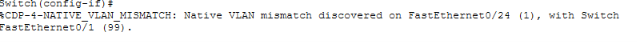
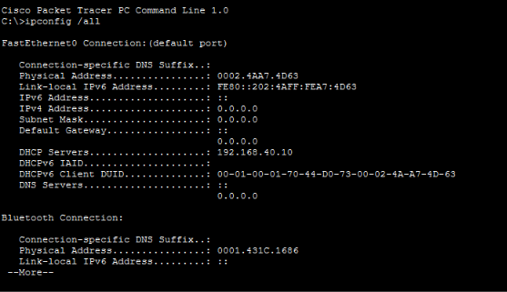
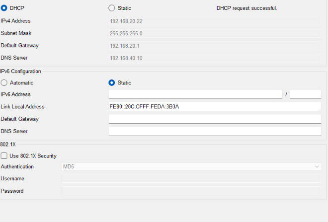
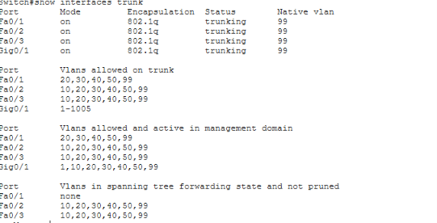
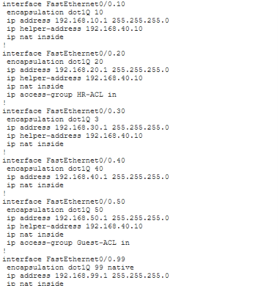
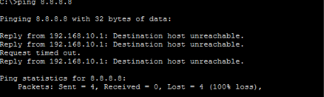

# Troubleshooting Notes

Once the campus network was fully working, I broke it on purpose, one fault at a time, and tried to find the cause using only `show` commands and the logs. All six faults were fixed and the network was re-tested before I moved on to the next one, and the final configs in this repo are from the working state.

For each fault I wrote down what the user would notice, the steps I took to find the problem, and the exact misconfiguration.

---

## Fault 1: Native VLAN mismatch on a trunk

**Symptom**
Shortly after the change, the console on SW-Core started printing repeated native VLAN mismatch messages and spanning tree errors. VLAN 99 traffic stopped passing on the affected links, and the management address of the switch became unreachable.

**Diagnosis**
1. Read the log. It had `CDP-4-NATIVE_VLAN_MISMATCH` and `SPANTREE-2-BLOCK_PVID_LOCAL` messages, which both point to a trunk problem rather than an IP problem.
2. Ran `show interfaces trunk` on SW-Core and then on SW1. SW-Core listed native VLAN 99, but the uplink on SW1 listed native VLAN 1.
3. Ran `show cdp neighbors` to confirm which switch was on the other end of the link.

**Root cause**
The uplink on SW1 (Fa0/24) was back on the default native VLAN 1, while the other end of the trunk was set to VLAN 99. Both ends of a trunk must use the same native VLAN.

---

## Fault 2: DHCP relay missing on a subinterface

**Symptom**
A Sales PC that renewed its address came back with a 169.254.x.x address and had no gateway. PCs in the other VLANs still got normal addresses.

**Diagnosis**
1. Ran `ipconfig /all` on the Sales PC and saw the 169.254 address, which means no DHCP server replied.
2. Checked a PC in another VLAN. It got an address fine, so the server and its pools were working, and the problem was only in VLAN 10.
3. On R1, ran `show running-config | include helper`. Only three helper-address lines showed up, and the one for VLAN 10 was missing.

**Root cause**
`ip helper-address 192.168.40.10` was missing from the Fa0/0.10 subinterface, so the router never forwarded the Sales PCs' DHCP broadcasts to the server in VLAN 40.

---

## Fault 3: PC port in the wrong VLAN

**Symptom**
One Sales PC could not reach its gateway or any other device outside its own port. When it renewed DHCP, it received a 192.168.20.x address, which belongs to HR.

**Diagnosis**
1. Checked the address on the PC. It was in the HR range, so the PC was clearly landing in the wrong VLAN.
2. Ran `show vlan brief` on SW1. The PC's port (Fa0/1) was listed under VLAN 20 (HR) instead of VLAN 10 (Sales).
3. Ran `show interfaces fa0/1 switchport` to confirm the access VLAN setting.

**Root cause**
The access port was configured with `switchport access vlan 20` instead of `switchport access vlan 10`.

---

## Fault 4: VLAN missing from the trunk allowed list

**Symptom**
Sales PCs could not reach their gateway or each other across switches. Every other VLAN worked normally.

**Diagnosis**
1. Only one VLAN was affected, and its access ports and addresses looked correct, so I suspected the trunk.
2. Ran `show interfaces trunk` on SW-Core and looked at the "allowed on trunk" list for the uplink to SW1. VLAN 10 was not in it, while the other trunks still listed it.
3. Compared the output with the other trunk ports to confirm the difference.

**Root cause**
VLAN 10 had been removed from the allowed VLAN list on the SW-Core trunk (`switchport trunk allowed vlan remove 10`), so tagged VLAN 10 frames were not allowed to cross the link.

---

## Fault 5: Wrong encapsulation number on a subinterface

**Symptom**
IT PCs could not ping their gateway (192.168.30.1) or anything outside VLAN 30. Pings between two IT PCs still worked, and every other VLAN was fine.

**Diagnosis**
1. Ran `show ip interface brief` on R1. The Fa0/0.30 subinterface showed up/up, so nothing looked wrong from the status alone.
2. Ran `show vlan brief` on SW2 to confirm the IT PCs were in VLAN 30.
3. Ran `show running-config interface fa0/0.30` on R1. The encapsulation line said `dot1Q 31`.

**Root cause**
Subinterface Fa0/0.30 was set to `encapsulation dot1Q 31`. The IT PCs send frames tagged with VLAN 30, so the router never matched them to a subinterface, and nothing answered for the gateway address.

---

## Fault 6: Default route missing on R1

**Symptom**
All internal VLANs could still reach each other and the server, but nobody could reach 8.8.8.8. The ping returned "destination host unreachable" from the gateway.

**Diagnosis**
1. Since the internal network worked and only the internet did not, I focused on R1 and the link to the ISP.
2. Pinged 203.0.113.1 (the ISP router) from R1 and it replied, so the physical link and addressing were fine.
3. Ran `show ip route` on R1. There was no line starting with `S*`, which means no default route.

**Root cause**
The static default route `ip route 0.0.0.0 0.0.0.0 203.0.113.1` had been removed, so R1 had no path for traffic to any outside network.

---

## The method I followed each time

1. Work out who is affected: one PC, one VLAN, or everyone.
2. Check what still works, because that rules out a lot.
3. Go through the layers in order: link and port, VLAN, IP address, routing, then ACL or NAT.
4. Use the `show` command that matches the layer.
5. Change one thing, then re-test.
